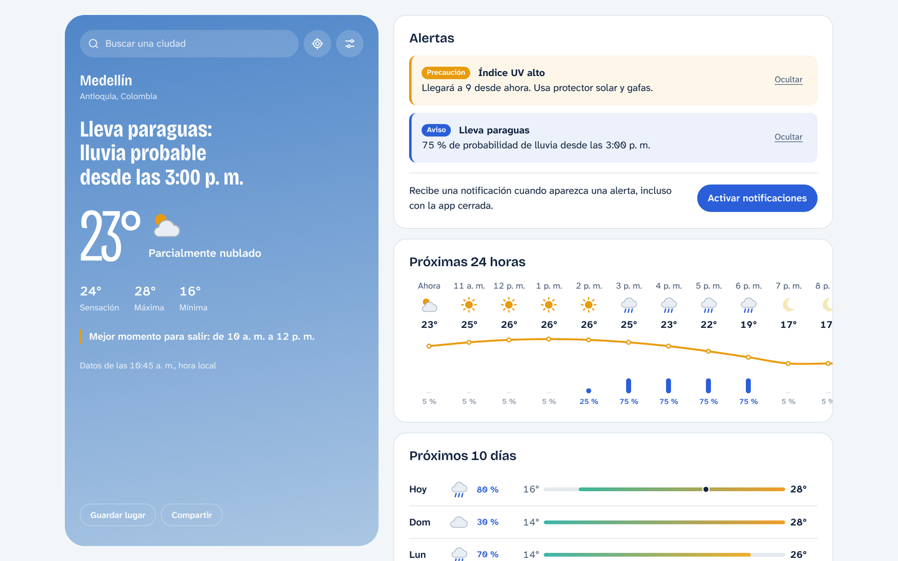
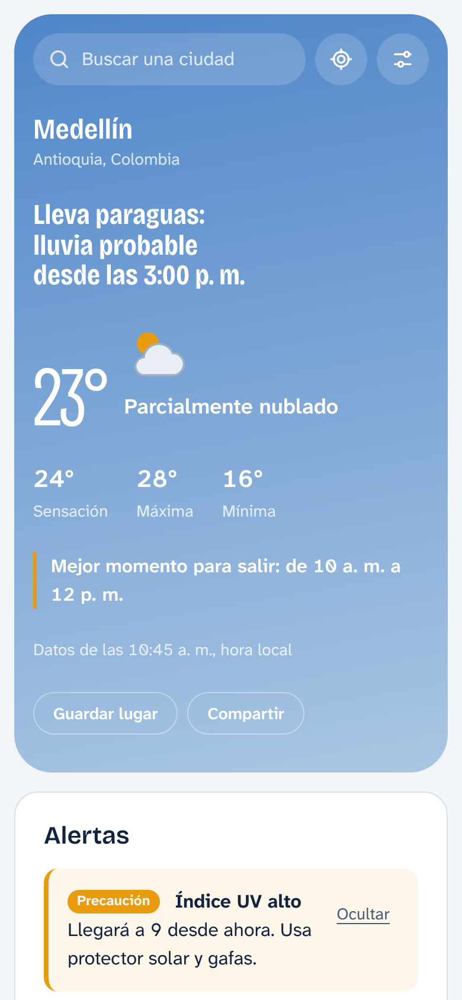
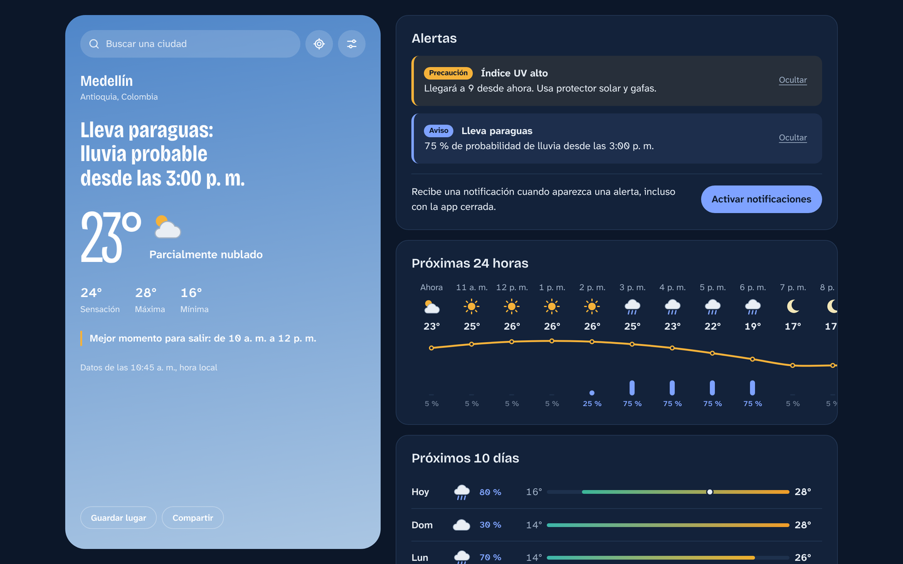

# Clima: pronóstico y alertas

Aplicación del clima que no solo muestra números: te dice qué hacer. "Lleva paraguas: lluvia
probable desde las 3:00 p. m." es el titular, no un dato escondido en una tabla. Avisa de
tormentas, lluvia fuerte, calor, frío, UV, viento y mala calidad del aire, y puede notificarte
incluso con la app cerrada.

**Demo:** https://jhon-david-toro.github.io/clima-app/



| Móvil                                      | Tema oscuro                                 |
| ------------------------------------------ | ------------------------------------------- |
|  |  |

## Funcionalidades

- **Consejo del momento:** titular en lenguaje natural según lluvia, tormentas, UV o la
  comparación con ayer, y el mejor rato de luz para salir.
- **Alertas** de tormenta, lluvia fuerte, probabilidad de lluvia, calor, frío, UV, ráfagas y
  calidad del aire, con umbrales configurables y severidad (aviso, precaución, peligro).
- **Notificaciones** del navegador mientras la app está abierta y, en Chrome y Edge con la app
  instalada, revisión en segundo plano con
  [Periodic Background Sync](https://developer.mozilla.org/docs/Web/API/Web_Periodic_Background_Synchronization_API).
  Nunca se notifica dos veces la misma alerta.
- **Pronóstico** de 24 horas con curva de temperatura y de 10 días con barras de rango.
- **Detalles:** viento con brújula, UV, arco solar, calidad del aire (AQI y PM2.5), humedad,
  lluvia, visibilidad y presión.
- **Búsqueda de ciudades** accesible (patrón combobox de WAI-ARIA), geolocalización y hasta 8
  lugares guardados.
- **Enlaces compartibles:** la ubicación vive en la URL (`?lat=…&lon=…&name=…`).
- **PWA instalable y offline:** el último pronóstico queda en caché y la app avisa cuando hay
  una versión nueva.
- **Ajustes:** °C/°F, km/h, mph o m/s, tema claro, oscuro o del sistema.
- El cielo cambia de color según la condición real y si es de día o de noche.

## Stack

- **Angular 22** sin zone.js, con componentes standalone, signals, `httpResource`, control de
  flujo nativo (`@if`, `@for`), `input()`/`output()` y `@Service()`.
- **TypeScript 6** en modo estricto, más `noUncheckedIndexedAccess`,
  `exactOptionalPropertyTypes` y `strictTemplates`. Cero `any`, verificado por ESLint.
- **SCSS** con módulos `@use`, parciales, mixins de breakpoints y accesibilidad, y tokens como
  custom properties para el tema en tiempo de ejecución.
- **Open-Meteo** para pronóstico, calidad del aire y geocodificación: datos abiertos, sin API key
  y sin secretos en el repositorio.
- **Vitest** para pruebas unitarias y de componentes.
- **ESLint** (`typescript-eslint` strict + `angular-eslint` + accesibilidad), **Stylelint** y
  **Prettier**.

## Arquitectura

El código se organiza por funcionalidad, como recomienda la
[guía de estilo de Angular](https://angular.dev/style-guide):

```
src/
├── app/
│   ├── alerts/          Reglas de alertas (puras), AlertCenter y lista de alertas
│   ├── forecast-page/   Página principal: compone el resto y sincroniza la URL
│   ├── location/        Búsqueda, geolocalización y lugares guardados
│   ├── notifications/   Notificaciones del navegador y revisión en segundo plano
│   ├── pwa/             Instalación y aviso de nuevas versiones
│   ├── settings/        Ajustes persistidos y su panel
│   ├── shared/          Unidades, formato de horas, almacenamiento, pipes
│   └── weather/         Contrato con Open-Meteo, modelo, consejos y vistas del pronóstico
├── service-worker/      Revisión de alertas en segundo plano
├── styles/              Parciales SCSS: tokens, cielo, base, utilidades, mixins
└── testing/             Datos de prueba deterministas
```

Decisiones clave:

- **Datos no confiables validados en tiempo de ejecución.** Las respuestas de la API, el
  `localStorage`, IndexedDB y la URL pasan por guards antes de entrar al modelo tipado.
- **Lógica pura y compartida.** Las reglas de alertas, el mapeo de la API y los consejos no
  dependen de Angular. Por eso el service worker reutiliza exactamente el mismo código, que
  esbuild empaqueta en `sw.js` junto al `ngsw-worker.js` de Angular.
- **Unidades métricas internas.** Todo se guarda en °C y km/h y solo se convierte al mostrarlo,
  así que cambiar de unidad no repite peticiones.
- **Horas en la zona de la ubicación,** no en la del dispositivo: consultar Tokio desde Bogotá
  muestra horas de Tokio.

## Desarrollo

Requiere Node 22.12 o superior.

```bash
npm ci
npm start             # http://localhost:4200
npm test              # pruebas en modo watch
npm run lint          # ESLint + Stylelint
npm run typecheck     # app, service worker y pruebas
npm run build         # build de producción con service worker
```

El service worker solo se activa en el build de producción. Para probarlo, sirve
`dist/clima-app/browser` en `localhost`.

## Despliegue

GitHub Actions verifica formato, lint, tipos, pruebas y build en cada pull request. Cada push a
`main` publica la app en la rama `gh-pages`.

## Créditos

Datos del clima de [Open-Meteo](https://open-meteo.com/) (CC BY 4.0). Nombres de lugares por
geolocalización de [BigDataCloud](https://www.bigdatacloud.com/). Las alertas se calculan a
partir del pronóstico y no reemplazan los avisos oficiales.
